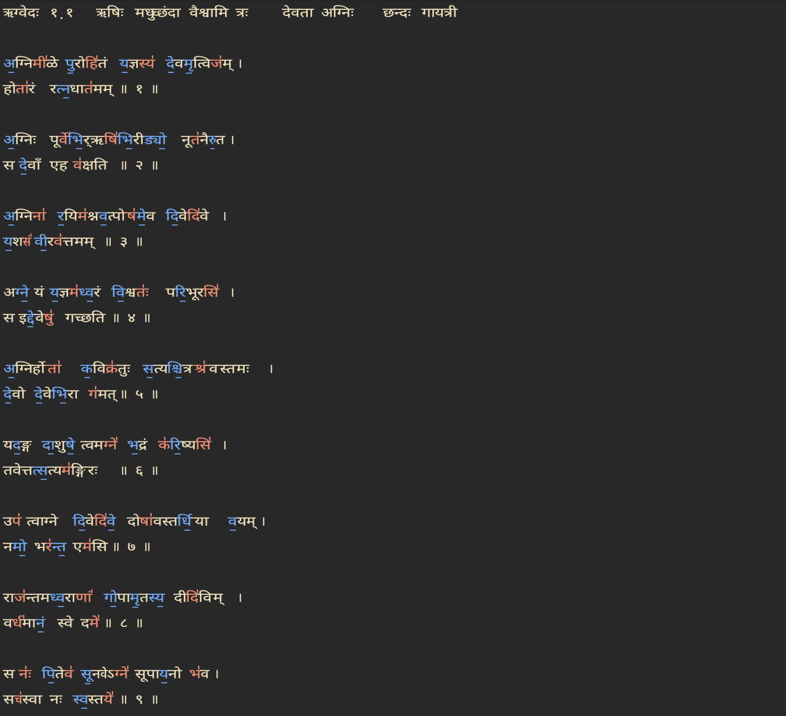
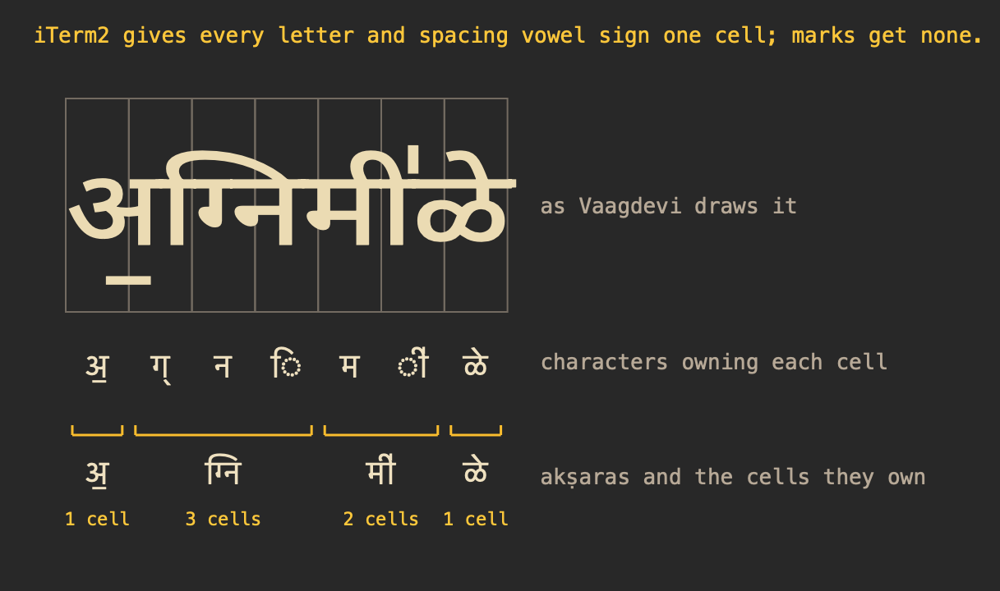

# Vaagdevi (वाग्देवी)

**A terminal font for accented Vedic Sanskrit in iTerm2.**

Vaagdevi renders Devanagari with its svara marks (anudātta ॒, svarita ॑, kampa
and pluta) correctly on the terminal grid. Conjuncts join, vowel signs sit in
the right place, words are set as in print, and columns stay aligned.


*Ṛgveda 1.1 (`cat examples/rv-1.1.txt`) in iTerm2, Monaco 12 with Vaagdevi as
the non-ASCII font and 1.3 line spacing.*

| Without Vaagdevi | With Vaagdevi |
|---|---|
|  |  |

Without it, iTerm2 falls back to a macOS Devanagari font, and the shaped
glyphs get pulled apart by the terminal grid. Half forms disappear, ि lands a
cell away from its consonant, and svara marks drift.

**Svara mode** colours every akṣara by its svara, anudātta blue and svarita
salmon. Type `svara on` and `svara off` to switch it in any tab (see
[Svara colours](#svara-colours)).

---

## Contents

- [Quick start](#quick-start)
- [Setting up iTerm2](#setting-up-iterm2)
- [Svara colours](#svara-colours)
- [What it handles](#what-it-handles)
- [How it works](#how-it-works)
- [Building from source](#building-from-source)
- [Development tools](#development-tools)
- [Limits](#limits)
- [Sources and license](#sources-and-license)

## Quick start

Requirements: macOS, iTerm2 3.5, and Homebrew Python 3.12 or newer (for building).

```sh
git clone https://github.com/bhairavananda/vaagdevi-lipi.git
cd vaagdevi-lipi
make venv        # create .venv with fontTools, uharfbuzz, pyobjc
make             # build both fonts into dist/ and run the checks
make install     # install both fonts and the "Vaagdevi" / "Vaagdevi Svara" iTerm2 profiles
```

Open a new iTerm2 window with the **Vaagdevi** profile (Profiles menu, or
⌘O) and try it:

```sh
cat examples/rv-1.1.txt
```

For the svara toggle, add this to your `~/.zshrc` (or `~/.bashrc`):

```sh
source /path/to/vaagdevi-lipi/shell/svara.sh
```

## Setting up iTerm2

Vaagdevi is a **companion font**. Your usual monospace font (Monaco, Menlo,
SF Mono) keeps drawing ASCII, and Vaagdevi draws Devanagari and IAST.

`make install` sets this up for you. It adds two iTerm2 profiles, **Vaagdevi**
and **Vaagdevi Svara**, that inherit everything from your default profile and
change only the three settings below. If your main font isn't 12 pt, use
`.venv/bin/python install.py --size 14`; to inherit from another profile, add
`--parent "Profile name"`. After installing a new build, quit and reopen
iTerm2, because macOS caches fonts by name.

To set up a profile of your own instead, go to **iTerm2 → Settings →
Profiles → *your profile* → Text**:

1. **Turn on "Use a different font for non-ASCII text"** and choose
   **Vaagdevi** at the same size as your main font.
2. **Turn on ligatures for the non-ASCII font.** This is required: it is the
   only mode in which iTerm2 shapes Devanagari at all. Your ASCII font is
   unaffected.
3. **Set vertical spacing to 130%.** Svara marks reach above and below
   Monaco's line. At 100% the marks of neighbouring lines nearly touch, and
   the deepest anudātta (under ु) can run into the tallest svarita (on ो) on
   the next line:

   

Vaagdevi's cells are 0.6 em wide, which matches Monaco, Menlo and most
monospace fonts, so Devanagari and ASCII share the grid exactly.

## Svara colours



Svara mode is a second font, **Vaagdevi Svara**, that is Vaagdevi with colour
built in:

| Akṣara | Colour |
|---|---|
| carries an anudātta ॒ | blue |
| carries a svarita ॑ or kampa ᳚ | salmon |
| carries both | violet |
| unmarked (udātta or pracaya) | the terminal's text colour |

### Turning it on and off

`make install` creates one profile per font: **Vaagdevi** (plain) and
**Vaagdevi Svara** (coloured). The toggle switches the current tab between
them. With `shell/svara.sh` sourced in your shell:

```sh
svara on      # this tab switches to Vaagdevi Svara: svaras in colour
svara off     # back to plain Vaagdevi
svara         # toggle
```

The switch is instant and recolours everything already on screen, so you can
`cat` a sūkta and then flip between the two views. Each tab is independent.

Other ways to switch:

- **Any shell or program** can send the escape sequence itself:
  `printf '\e]1337;SetProfile=Vaagdevi Svara\a'` (and `SetProfile=Vaagdevi`
  to switch back). It works over ssh too, since the sequence travels with
  the output.
- **iTerm2's menus:** open a new tab or window with either profile from the
  **Profiles** menu.
- **Always on:** make Vaagdevi Svara your default profile (Settings →
  Profiles → Other Actions → Set as Default).

Inside **tmux**, `svara` wraps the sequence so tmux passes it through; this
needs `set -g allow-passthrough on` (tmux 3.3 or later). If your profiles
have other names, set `VAAGDEVI_PLAIN_PROFILE` and `VAAGDEVI_SVARA_PROFILE`
before sourcing the script.

### Why it's a font, not terminal colours

iTerm2 starts a new shaping run whenever the text colour changes
(`shouldSegmentWithAttributes` in `iTermAttributedStringBuilder.m`). Colouring
akṣaras with ANSI escape codes would therefore cut every word at each colour
change and undo the word packing described below. Vaagdevi Svara stores the
colours in the font's COLR/CPAL tables instead, so iTerm2 sees one run of one
colour and the font paints each akṣara.

## What it handles

| | Example |
|---|---|
| Vowel signs before and after the consonant | कि की का को |
| Conjuncts, half forms, reph, rakāra | क्ष ज्ञ ग्नि र्क प्र ष्ट्र |
| Words set as in print, spare cells after the word | अ॒ग्निमी॑ळे पु॒रोहि॑तं |
| Anudātta on one fixed low line | ई॒ळे॒ र॒त्न॒धात॑मम् |
| Svarita on one fixed line, distinct from anusvāra | ज॑ vs जं |
| Kampa | अ॒प्स्व१॒॑न्तः, रा॒यो॒३॒॑ऽवनिः |
| Pluta | आ॒सी३त् |
| Candrabindu, avagraha, daṇḍas, Devanagari digits | दे॒वाँ, सोऽवनिः, ॥ १ ॥ |
| IAST with accents | agním īḻe puróhitaṃ |

## How it works

iTerm2 gives every letter and spacing vowel sign one cell, and combining marks
none, so an akṣara owns anywhere from one cell to several:



It also re-places every shaped glyph by the terminal cell of the
character it came from. That's harmless for Latin but tears Devanagari apart,
because Devanagari draws some glyphs out of character order. Vaagdevi turns
every akṣara into a **single composite glyph**, taken from Noto Sans
Devanagari's own layout and pre-shifted by exactly the amount iTerm2 will
move it. iTerm2 can't pull a single glyph apart.

On top of that:
- **Words are packed.** iTerm2 gives each letter and spacing vowel sign a
  whole cell, so रो or हि get 2 cells for about 1.2 cells of letter. Every
  akṣara is drawn at its natural width (all 20% wider than Noto, the same
  for every letter) and pulled left by the spare room of the akṣaras before
  it, so a word reads as in print and its spare cells collect after it. A
  contextual GSUB lookup picks each akṣara's pre-shifted copy from the one
  before it.

  

- **Anudātta and svarita sit on fixed lines**, as they read in recitation.

  

The full explanation, including the iTerm2 source behaviour this is built
around, is in **[docs/how-it-works.md](docs/how-it-works.md)**.

## Building from source

```sh
make venv     # once: Python venv with requirements.txt
make          # build both fonts + verify
make font     # Vaagdevi only → dist/Vaagdevi-Regular.ttf
make svara    # Vaagdevi Svara → dist/VaagdeviSvara-Regular.ttf (after make font)
make verify   # run both checks
make install  # install both fonts and the Vaagdevi / Vaagdevi Svara profiles
make dev      # build and install both into iTerm2 under fresh names, for testing
make diagrams # redraw the explanatory diagrams from the built font
make screenshots  # retake the README screenshots in iTerm2
make clean    # remove dist/
```

The build has three stages:

| Stage | Script | What it does |
|---|---|---|
| 1 | `build.py` | Instances Noto Sans Devanagari (weight 500), fits every glyph to the 600-unit cell grid, adds reph and rakāra headline filler, zeroes GPOS advance changes, and merges with Noto Sans Mono |
| 2 | `ligate.py` | Adds one composite glyph per akṣara from Noto's natural layout (svara on fixed lines), its pre-shifted copies for packing, and the GSUB lookups that substitute them |
| 3 | `svara_color.py` | Copies the font as Vaagdevi Svara and adds COLR/CPAL colour by svara |

Checks, run by `make verify`:

| Script | What it checks |
|---|---|
| `verify.py` | HarfBuzz: every Ṛgveda word's width equals the cells iTerm2 gives it |
| `verify_iterm.py` | CoreText plus a port of iTerm2's glyph placement: every glyph lands where intended |

Current result: **457,198 of 457,202** Ṛgveda word occurrences are drawn
correctly. The four misses are typos in the source text (doubled vowel signs).

## Development tools

| Tool | Use |
|---|---|
| `preview.py out.png "text" …` | Draws text exactly as iTerm2 will (CoreText plus iTerm2's placement rule and row height), so you can check rendering without a screenshot. Set `SIZE=110` to see details, `LINE_SPACING=1.0` to compare row heights. |
| `make dev` / `install_dev.py` | Installs the current builds as `Vaagdevi Dev <time>` and `Vaagdevi Svara Dev <time>` and points the **Vaagdevi Test** and **Vaagdevi Svara Test** profiles at them. macOS caches fonts by name, so reusing a name would leave a running iTerm2 drawing the old build. |
| `make screenshots` / `screenshots.py` | Opens iTerm2 windows without Vaagdevi, with it and with Vaagdevi Svara, captures them to `docs/images/`, and closes them. Needs Screen Recording permission for your terminal app. Options: `--profile`, `--svara-profile`, `--text`, `--name`. |
| `make diagrams` / `diagrams.py` | Redraws the four diagrams in `docs/images/` with the built font, each line placed as iTerm2 places it. |
| `probe.py` | Run inside iTerm2: measures how many cells it gives each test string (`data/probe_results.json`) |

The packing and spacing settings are at the top of `ligate.py` (`XSCALE`,
`OVERHANG`, `TRACK_*`, `PACK_*`); `LINE_SPACING` is in `build.py`.

Repository layout:

```
build.py  ligate.py  svara_color.py   the build
verify.py  verify_iterm.py            the checks
install.py  shell/svara.sh            installing, and the svara toggle
preview.py  diagrams.py  probe.py  install_dev.py  screenshots.py
data/rigveda_words.tsv        every distinct word of the accented Ṛgveda, with counts
data/probe_results.json       iTerm2 cell measurements
examples/rv-1.1.txt           Ṛgveda 1.1, for trying the font
sources/                      Noto Sans Devanagari and Noto Sans Mono (OFL)
docs/how-it-works.md          the technical explanation
DESIGN.md                     the original design and measurements
```

## Limits

- **iTerm2 only** (3.5, macOS). Other terminals place glyphs differently.
- **Spacing between words varies.** The space between words is ASCII, so
  iTerm2 draws it with your main font, and Vaagdevi can't see across it. A
  word keeps the cells iTerm2 gives it: a word with many conjuncts
  (स॒त्यश्चि॒त्रश्र॑वस्तमः) has spare room, which is partly spread inside the
  word as small gaps bridged by the shirorekha and partly left after it.
- **Packing covers the Ṛgveda.** Pre-shifted copies exist for every akṣara at
  every position it takes in the Ṛgveda. Other texts mostly reuse them; where
  one is missing, the word restarts from its cell and shows a gap.
- **Svara colours can't tell udātta from pracaya.** Both are unmarked, and
  which one an akṣara is depends on the akṣaras before it, across word
  boundaries the font can't see.
- **The font is near OpenType's glyph limit** (about 54,500 of 65,535), so
  adding more texts would need a coarser shift step.
- **Wide letters at the start of a word** (आ, औ) are narrowed or use Noto's
  condensed design.

## Sources and license

The font is built from **Noto Sans Devanagari** and **Noto Sans Mono** by The
Noto Project Authors, both under the SIL Open Font License 1.1. Vaagdevi is
released under the same license: see [`OFL.txt`](OFL.txt), with every change
from the sources listed in [`FONTLOG.txt`](FONTLOG.txt).

`data/rigveda_words.tsv` and `examples/rv-1.1.txt` are from the accented
Ṛgveda saṃhitā and padapāṭha, which are in the public domain.
