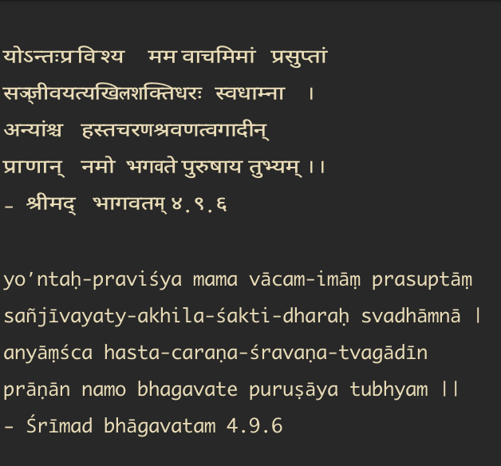
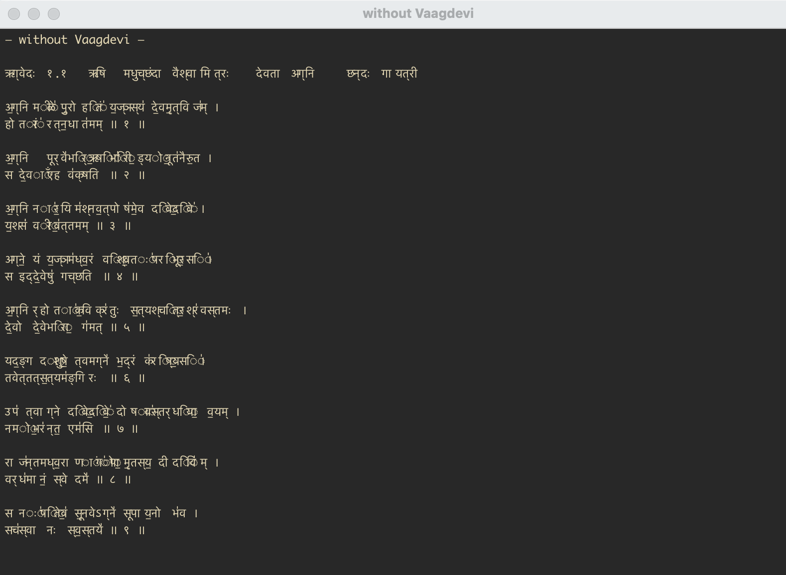
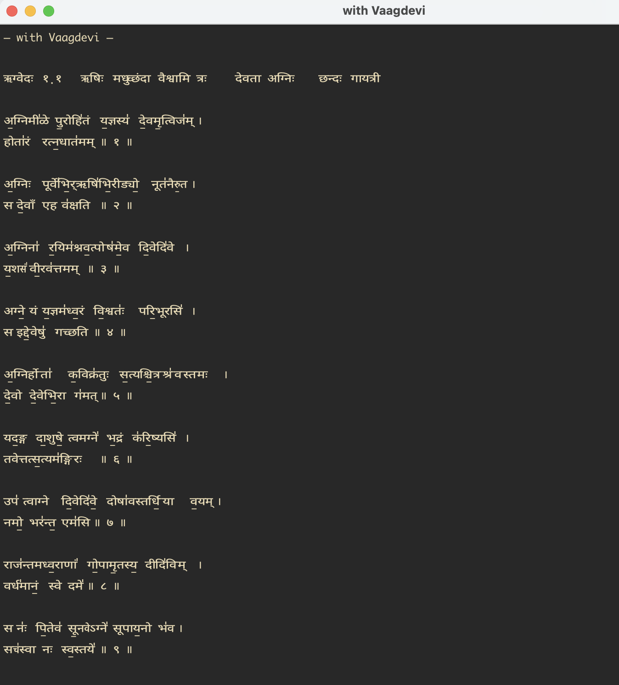
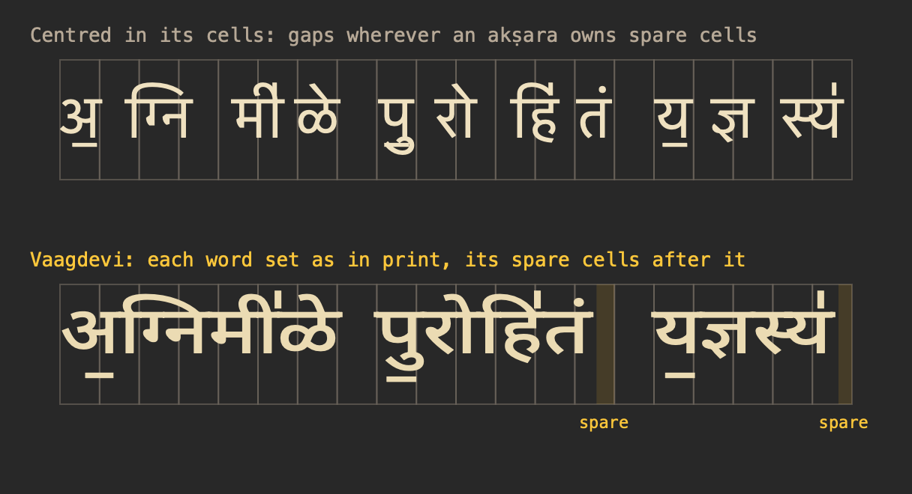
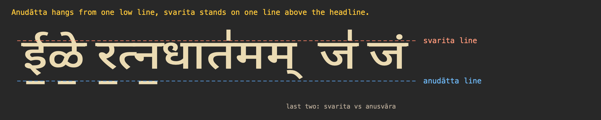
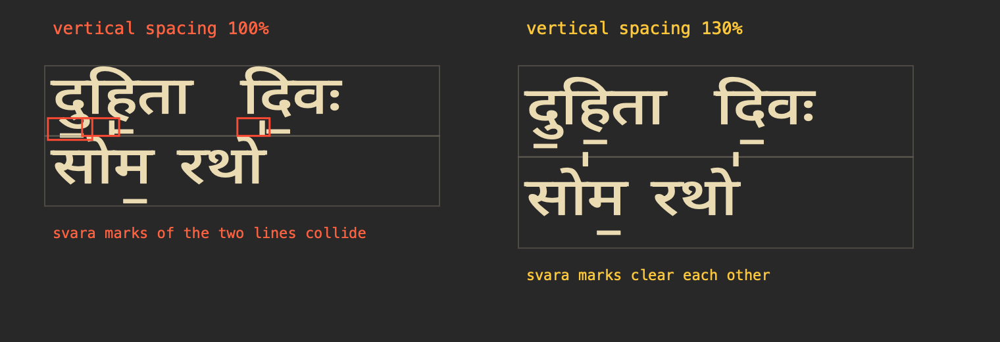

# Vaagdevi (वाग्देवी)



> *He who enters within me and, by His own splendour, brings to life this
> sleeping speech of mine, and the other senses too, hands, feet, ears and
> skin, and the life-breath: to You, the Lord, the Supreme Person, I bow.*
>
> Śrīmad Bhāgavatam 4.9.6, Dhruva's prayer, as Vaagdevi draws it in iTerm2.

Vaagdevi is a font for reading and writing Sanskrit in the terminal, accented
Vedic text included. It sits next to your usual monospace font in iTerm2 and
takes over the Devanagari: conjuncts join up, vowel signs land on the right
letter, svara marks sit on level lines, and every column stays where your
tools expect it.

It's named after Vāgdevī, the goddess of speech, which felt right for a font
whose whole job is to let the text speak properly.

| Without Vaagdevi | With Vaagdevi |
|---|---|
|  |  |

*Ṛgveda 1.1 in iTerm2. On the left, macOS's own Devanagari font gets pulled
apart by the terminal grid.*

## Installing

You'll need iTerm2 3.5 on macOS. Then:

```sh
curl -fsSL https://github.com/bhairavananda/vaagdevi-lipi/releases/latest/download/install.sh | sh
```

That downloads the two fonts, the svara toggle, the Sanskrit typing mode and
the Neovim preview, and adds two iTerm2 profiles, **Vaagdevi** and **Vaagdevi Svara**. Both copy your default profile and change only the
Devanagari font, so your colours, keys and main font come along unchanged.
Quit and reopen iTerm2, open a window with the Vaagdevi profile from the
Profiles menu, and try something:

```sh
curl -fsSL https://raw.githubusercontent.com/bhairavananda/vaagdevi-lipi/main/examples/rv-1.1.txt
```

If your main font isn't 12 pt, run the installer with `VAAGDEVI_SIZE=14`
(or whatever you use) in front of `sh`. To have every new tab open with
Vaagdevi, make it your default profile: Settings → Profiles, select
Vaagdevi, then Other Actions → Set as Default. (From a checkout,
`.venv/bin/python install.py --parent "Your Profile" --default` does the
same, and takes effect the next time iTerm2 starts.) The script is short and only writes
to `~/Library/Fonts`, iTerm2's profile folder and `~/.local/share/vaagdevi`,
so feel free to read [`install.sh`](install.sh) before you run it.

### Setting it up by hand

If you'd rather add Vaagdevi to a profile you already have, download
`Vaagdevi-Regular.ttf` from the [latest release][release], double-click it to
install, and in **iTerm2 → Settings → Profiles → Text**:

1. Turn on **Use a different font for non-ASCII text** and pick Vaagdevi at
   the same size as your main font.
2. Turn on **ligatures** for that non-ASCII font. iTerm2 only shapes
   Devanagari when ligatures are on, and your main font isn't affected.
3. Set **vertical spacing** to 130%, so svara marks on one line have room to
   clear the next.

Vaagdevi's cells are 0.6 em wide, the same as Monaco, Menlo, SF Mono and most
other monospace fonts, so Devanagari and ASCII share one grid.

[release]: https://github.com/bhairavananda/vaagdevi-lipi/releases/latest

## Seeing the svaras in colour


The second font, **Vaagdevi Svara**, colours each akṣara by its accent:
anudātta in blue, svarita (and kampa) in salmon, and both together in violet.
Unmarked akṣaras keep your normal text colour. Texts without accents, like
the Bhāgavatam verse above, simply stay that colour throughout.

To switch it on and off, add the toggle to your `~/.zshrc` or `~/.bashrc`
(the installer prints the exact line):

```sh
source ~/.local/share/vaagdevi/svara.sh
```

and then, in any tab:

```sh
svara on     # colours
svara off    # plain
svara        # flip between them
```

The switch happens straight away and recolours whatever is already on the
screen, so you can `cat` a sūkta and then flip back and forth. Each tab keeps
its own setting. Under the hood it's iTerm2's `SetProfile` escape sequence,
which means a few other things work too:

- Any program can switch by printing
  `printf '\e]1337;SetProfile=Vaagdevi Svara\a'` (or `SetProfile=Vaagdevi`),
  and that works over ssh as well.
- You can open a tab with either profile from iTerm2's Profiles menu, or make
  Vaagdevi Svara your default profile if you'd like colour all the time.
- In tmux, `svara` wraps the sequence so tmux passes it through. Turn on
  `set -g allow-passthrough on` (tmux 3.3 or newer) for that.

You might wonder why this is a second font and not ordinary terminal colours.
iTerm2 starts a new run of text whenever the colour changes, and Devanagari
shaping can't see across those runs, so colouring each akṣara with escape
codes would pull the words apart again. Putting the colour inside the font
keeps every word in one run.

## Typing Sanskrit

Vaagdevi draws Devanagari, but your keyboard types Latin. The `skt` mode
bridges that in zsh: you type Baraha transliteration and the command line
fills with real Devanagari as you go, which Vaagdevi then renders. Add it to
your `~/.zshrc` (the installer prints the exact line):

```sh
source ~/.local/share/vaagdevi/skt.zsh
```

Then type `skt` and press Enter. A small **संस्कृत** appears on the right of
your prompt, and from there each word turns into Devanagari while you type
it. Backspace takes back the last letter you typed. Press **Ctrl-X** and
then **t** to switch back to plain typing; you can also use it to switch on
in the middle of a line. (Typing `skt` again wouldn't work, since in Sanskrit
mode it becomes स्क्त्.)

```
aqgnimI#LE puqrOhi#taM yaqj~jasya# dEqvamRuqtvija#m |
अ॒ग्निमी॑ळे पु॒रोहि॑तं य॒ज्ञस्य॑ दे॒वमृ॒त्विज॑म् ।
```

`skt` also works outside the mode, for a quick line or a whole file:

```sh
skt 'aqgnimI#LE'           # अ॒ग्निमी॑ळे
skt < sukta.brh > sukta.txt
```

The scheme is standard Baraha, with one change for Sanskrit: since there's
no short e or o, plain `e` and `o` give ए and ओ (Baraha's `E` and `O` work
too). The essentials:

| Type | Get | | Type | Get |
|---|---|---|---|---|
| `a A i I u U` | अ आ इ ई उ ऊ | | `Ru RU` | ऋ ॠ |
| `e ai o au` | ए ऐ ओ औ | | `M H ~M` | ं ः ँ |
| `k kh g gh ~g` | क ख ग घ ङ | | `ch Ch j jh ~j` | च छ ज झ ञ |
| `T Th D Dh N` | ट ठ ड ढ ण | | `t th d dh n` | त थ द ध न |
| `p ph b bh m` | प फ ब भ म | | `y r l v` | य र ल व |
| `sh Sh s h L` | श ष स ह ळ | | `kSh j~j` | क्ष ज्ञ |
| `q` after a vowel | anudātta ॒ | | `#` after a vowel | svarita ॑ |
| `$` after a vowel | dīrgha svarita ᳚ | | `\| \|\|` | । ॥ |
| `&` | ऽ | | `_` | keeps letters apart: `ka_i` कइ |

The converter is a small Python script with no dependencies
([`shell/skt.py`](shell/skt.py)), started once per shell and kept running,
so typing stays quick. It round-trips 99.996% of the accented Ṛgveda through
Baraha and back; the rest are typos in the source.

## Writing in Neovim

Neovim can show Devanagari, but it can't edit it well in a terminal: it
counts ि ा ी ो as taking no space, while iTerm2 gives each a cell, so the
cursor and anything you type on a Devanagari line land in the wrong place.
So the comfortable way is to write in Baraha in Neovim, where everything is
plain ASCII and every motion works, and let Vaagdevi show you the result
next to it.

Add the plugin at the end of your `~/.config/nvim/init.lua` (the installer
prints these lines). The second line loads it straight away, which also
works if a plugin manager like lazy.nvim handles your other plugins:

```lua
vim.opt.rtp:append(vim.fn.expand("~/.local/share/vaagdevi/nvim"))
vim.cmd.runtime("plugin/vaagdevi.lua")
```

Then, in any buffer:

| Command | Key | What it does |
|---|---|---|
| `:Vaagdevi` | `<leader>vv` | opens a preview pane beside Neovim, or closes it |
| `:VaagdeviSvara` | `<leader>vs` | svara colours on or off in the preview |
| `:VaagdeviConvert` | | turns the buffer, or the selected lines, into Devanagari |

The preview is a real iTerm2 pane drawn with Vaagdevi. It updates as you
type, follows your cursor (marked with ▸) and closes when you quit Neovim.
If the buffer already holds Devanagari, the preview shows it as it is;
otherwise it reads the buffer as Baraha. When you're done,
`:VaagdeviConvert` turns the buffer (or the lines you've selected) into
Devanagari, or `skt < sukta.brh > sukta.txt` does the same from the shell.

The keys are only set if you haven't mapped them already. Set
`vim.g.vaagdevi_no_mappings = true` to skip them, or `vim.g.vaagdevi_profile`
to use a different iTerm2 profile for the pane.

## How it works

Terminals think in cells. iTerm2 gives each letter and each spacing vowel
sign one cell, and gives combining marks none, so an akṣara can own anywhere
from one cell to several:


After a line is shaped, iTerm2 also moves each glyph back to the cell of the
character it came from. Devanagari draws some glyphs out of order (ि sits
before its consonant, reph after it), so that move tears akṣaras apart.
Vaagdevi avoids it by drawing every akṣara as one composite glyph, taken from
Noto Sans Devanagari's own layout and shifted ahead of time by exactly the
amount iTerm2 will move it.

The cell counting also means an akṣara like रो owns two cells but only needs
about one. Vaagdevi draws every akṣara at the same size and slides it left
by the room the akṣaras before it didn't use. Each word comes out set as it
would be in a book, with its spare cells after it:



The svara marks hang on fixed lines, the way you hear them in recitation:
every anudātta at the same depth, every svarita at the same height.



Those marks reach a little above and below the line of a normal monospace
font, which is why the profiles use 130% line spacing:



[`docs/how-it-works.md`](docs/how-it-works.md) has the full story, including
the parts of iTerm2's source this is built around.

## Things to know

- Vaagdevi is made for **iTerm2 on macOS**. Other terminals place glyphs in
  their own ways, so it won't line up there.
- **Spacing between words varies a little.** The space between two words is
  an ASCII character, so iTerm2 draws it with your main font and Vaagdevi
  can't see past it. Each word keeps the cells iTerm2 gave it, and words with
  many conjuncts end up with some extra room.
- The packing is worked out ahead of time for every word in the **Ṛgveda**
  and in [`examples/`](examples). Other texts mostly reuse the same pieces.
  When a word needs one that doesn't exist, it starts again from its own cell
  and you'll see a small gap.
- In colour mode, **udātta and pracaya** look the same. Both are unmarked in
  the text, and telling them apart needs the akṣaras before them, sometimes
  across a word boundary.

## Working on Vaagdevi

Welcome! The whole font is generated by a few Python scripts from Noto Sans
Devanagari and Noto Sans Mono, so you can change how it looks by changing
code and rebuilding. You'll need Homebrew Python 3.12 or newer.

```sh
git clone https://github.com/bhairavananda/vaagdevi-lipi.git
cd vaagdevi-lipi
make venv      # once: a .venv with fontTools, uharfbuzz and pyobjc
make           # build both fonts into dist/ and run the checks (about 40 s)
make dev       # install this build into iTerm2 as "Vaagdevi Test"
```

`make dev` installs each build under a fresh name, because macOS caches fonts
by name and a running iTerm2 would otherwise keep drawing the old one. It
also sets up **Vaagdevi Test** and **Vaagdevi Svara Test** profiles, so you
can try a build without touching your own. When you're happy with it,
`make install` installs it properly.

The build happens in three steps:

| Script | What it does |
|---|---|
| `build.py` | Takes Noto Sans Devanagari at weight 500, fits every glyph to the 600-unit cell grid, and merges in Noto Sans Mono |
| `ligate.py` | Builds one composite per akṣara, the shifted copies used for packing, and the substitution rules that pick them |
| `svara_color.py` | Makes the Vaagdevi Svara copy with colour tables |

`make verify` checks every word of the accented Ṛgveda. `verify.py` checks
that each word is exactly as wide as the cells iTerm2 gives it, and
`verify_iterm.py` runs a Python port of iTerm2's glyph placement to check
every glyph lands where it should. Right now 457,198 of 457,202 words pass;
the four that don't are typos in the source text.

A few tools make the loop quicker:

- `preview.py out.png "अ॒ग्निमी॑ळे"` draws text the way iTerm2 will, so you
  can check a change without a screenshot. `SIZE=110` zooms in.
- `make diagrams` redraws the diagrams in this README from the current build.
- `make screenshots` retakes the iTerm2 screenshots. It needs Screen
  Recording permission for your terminal app.
- To make a new text render fully packed, add it to `examples/` and rebuild.

The settings that shape the look (how wide akṣaras are drawn, how far a word
may run into the next space, how slack-heavy words spread out) are named
constants at the top of `ligate.py`, each with a comment saying what it does.
Line spacing and the version number live in `build.py`.

```
build.py  ligate.py  svara_color.py   the build
verify.py  verify_iterm.py            the checks
install.py  install.sh                installing from a checkout / from a release
shell/svara.sh                        the svara toggle
shell/skt.zsh  shell/skt.py           typing Sanskrit in Baraha
nvim/plugin/vaagdevi.lua              the Neovim live preview
preview.py  diagrams.py  install_dev.py  screenshots.py  probe.py
data/                                 the Ṛgveda word list and iTerm2 measurements
examples/                             texts to try, also packed by the build
sources/                              Noto Sans Devanagari and Noto Sans Mono
docs/                                 how-it-works.md and the images
DESIGN.md                             the original design notes
```

## License

Vaagdevi is built from Noto Sans Devanagari and Noto Sans Mono by the Noto
Project Authors, and like them it's released under the SIL Open Font License
1.1 ([`OFL.txt`](OFL.txt)). Every change from the original fonts is listed
in [`FONTLOG.txt`](FONTLOG.txt). The Ṛgveda and Bhāgavatam texts are in the
public domain.
